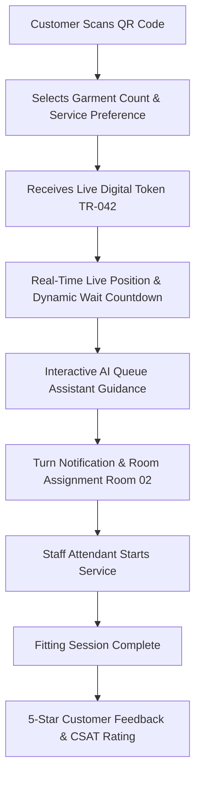

# Smart Trial Room Queue Management System

> **An enterprise full-stack digital queue-management and intelligent fitting platform for retail trial rooms.**  
> Built with **Spring Boot 3+ (Java 17/21)**, **Angular 19+**, **STOMP WebSockets**, and **Generative AI Queue Assistance**.

---

## 🏛️ System Role Architecture

```
                    SYSTEM
                       │
             ┌─────────┴─────────┐
             │                   │
          ADMIN                USERS
                                 │
                       ┌─────────┴─────────┐
                       │                   │
                    STAFF              CUSTOMER
```

### Database Roles (`Role.java`):
* `CUSTOMER` — Joins queue, tracks live position, gets audio/visual turn alert, gives feedback, chats with AI Assistant.
* `STAFF` — Operates fitting room desk, calls next customer, calls specific token, starts/completes fitting, skips/recalls, marks no-shows.
* `ADMIN` — System-wide governance, store management, staff accounts, queue priority rules, QR code generator, live multi-store monitor, reports & audit logs.

*(No Manager role required as per project specification)*

---

## 🚀 Key Features & Flow



### 1. Customer Experience (`/customer`)
* **QR Code Check-In**: Instant store entry without app installation.
* **Garment Count Selection**: Adaptive estimation calculating wait time dynamically based on the number of garments (1–6+ items).
* **Service Preference Types**: Standard Fitting, Express 2-Garment Line (< 4 min wait), VIP Styling Suite, Accessible/Family Room.
* **Live Digital Token Card**:
  ```
  ┌──────────────────────────┐
  │      MY QUEUE            │
  ├──────────────────────────┤
  │ Token: TR-042            │
  │                          │
  │ People Ahead: 3          │
  │ Estimated Wait: 12 min   │
  │                          │
  │ Now Serving: TR-039      │
  │                          │
  │ Status: WAITING          │
  │                          │
  │ [Cancel Queue]           │
  └──────────────────────────┘
  ```
* **Real-Time STOMP Updates**: Live ticket state synchronization across all connected devices.
* **Audio & Visual Turn Alert**: Multi-frequency harmonic turn chime + Room allocation banner.
* **AI Queue & Fit Assistant**: Natural language chatbot answering wait predictions, garment limits, sizing help, and store policies.
* **Post-Service CSAT Rating**: 5-Star rating with category breakdowns (Wait Speed, Staff Helpfulness, Room Cleanliness).

---

### 2. Staff Control Desk (`/staff`)
* **Real-time Queue Controller**:
  ```
  ┌──────────────────────────────┐
  │       STAFF DASHBOARD        │
  ├──────────────────────────────┤
  │ Now Serving: TR-038          │
  │                              │
  │ Waiting: 14                  │
  │                              │
  │ Next: TR-039                 │
  │                              │
  │ [CALL NEXT]                  │
  │                              │
  │ [START SERVICE] [COMPLETE]   │
  │                              │
  │ [SKIP] [RECALL] [NO-SHOW]   │
  └──────────────────────────────┘
  ```
* **Trial Room Status Grid**: Real-time room occupancy cards with live fitting duration timers.
* **Direct Token Calling**: Fast-track call for any specific token number (e.g. `TR-042`).
* **Shift Statistics**: Completed fittings, average service duration, active waiting count.

---

### 3. Admin Governance & Intelligence (`/admin`)
* **Executive Metrics**:
  * Users: `1,250`
  * Staff: `24`
  * Active Queues: `8`
  * Today's Customers: `486`
  * Average Wait: `9.4 min`
  * Customer Satisfaction: `4.8 / 5.0`
* **Reports & Visual Analytics**:
  * Hourly Customer Arrivals vs. Completions chart
  * Trial Room Utilization & Throughput heatmap
  * Staff Performance Leaderboard
  * **Generative AI Queue Insights**: Peak rush predictions, staffing recommendations, and bottleneck warnings.
* **Store & Room Management**: Add and configure retail stores and trial rooms.
* **Service Type Management**: Configure Express, VIP, and Standard limits.
* **Queue Priority Settings**: Buffer time, max garments, auto-no-show timeout, VIP multiplier.
* **Dynamic QR Code Generator**: Generate and download high-res printable store entrance posters.
* **Immutable Audit Logs**: Timestamped trail of all system, staff, and customer actions.

---

### 4. TV / Kiosk Signage Display (`/display/STR-NYC-01`)
* High-contrast public signage board showing **Now Serving** per trial room and **Up Next** queue list with live clock.

---

## 🔑 Pre-Seeded Demo Accounts

| Role | Username | Password | Purpose |
|---|---|---|---|
| **ADMIN** | `admin` | `admin123` | Full administrative control, settings, analytics & QR generator |
| **STAFF** | `staff1` | `staff123` | Fitting room desk attendant for Flagship Store |
| **STAFF** | `staff2` | `staff123` | Fitting room desk attendant for Century City |
| **CUSTOMER** | `customer1` | `customer123` | Customer with pre-seeded queue ticket |

*(A 1-Click Role Switcher is also available in the navbar and login page for instant demonstration)*

---

## 🛠️ Technology Stack

| Layer | Technologies |
|---|---|
| **Backend** | Java 17/21, Spring Boot 3.3.4, Spring Security, JWT (jjwt 0.12.6), Spring Data JPA, Spring WebSocket (STOMP + SockJS), Lombok, Maven |
| **Database** | PostgreSQL / H2 in-memory (dual profile support) |
| **Frontend** | Angular 19, TypeScript, RxJS, Chart.js, QRCode, Modern Glassmorphism CSS |
| **Real-Time** | STOMP protocol over WebSockets with SockJS fallback |
| **AI Assistant** | Natural Language Queue Intelligence Service with Intent Engine |

---

## 🏃 Running the Application

### 1. Launch Backend (Spring Boot)
Double-click `start-backend.bat` or run:
```powershell
cd backend
mvn spring-boot:run
```
*Backend runs at `http://localhost:8080` (H2 console at `http://localhost:8080/h2-console`)*

### 2. Launch Frontend (Angular)
Double-click `start-frontend.bat` or run:
```powershell
cd frontend
npm start
```
*Frontend opens at `http://localhost:4200`*
